# Plano para sa Seamless at Easy-to-Use ESP32 Rent & Return Flow

> **Project:** RENT & PLAY MANAGER  
> **Target Enterprise:** Lakewood Subdivision, Los Baños, Laguna  
> **Core Innovation:** Mobile QR Code Scanning + ESP32 Counter Verification Terminal (OLED, Buzzer, LED, Push Button via Wi-Fi REST API)

---

## 1. Vision: Bakit Kailangang "Seamless at Madaling Gamitin"?

Sa isang abalang rental shop o sa live thesis defense, **hindi dapat paulit-ulit na nagta-type ng forms ang staff**. Ang layunin:
1. **Isang scan lang sa phone camera**, kusa nang lalabas ang details.
2. **Isang tap lang sa phone**, gigising agad ang ESP32 sa counter (tutunog ang buzzer at magdi-display sa OLED).
3. **Isang pindot lang sa physical push button ng ESP32**, kumpirmado na ang transaksyon at kusa nang magko-close ang loading screen sa phone at mag-a-update ang web dashboard!

---

## 2. Ang Dalawang Pangunahing Seamless Flows

```mermaid
flowchart TD
    subgraph Rental["1. RENTAL FLOW (Paglabas ng Gamit)"]
        A[Staff opens Mobile Scanner] -->|Scans Equipment QR| B[Mobile displays Item & Booking Details]
        B -->|1-Tap: Send to ESP32| C[Backend sets PENDING_VERIFICATION]
        C -->|Wi-Fi API| D[ESP32 Chimes Buzzer & Lights LED]
        D -->|OLED shows RENTAL RELEASE| E[Staff presses Physical Button on ESP32]
        E -->|Wi-Fi POST| F[Backend activates Rental & Starts Timer]
        F -->|SSE Realtime| G[Mobile & Web update to ACTIVE]
    end

    subgraph Return["2. RETURN FLOW (Pagsauli ng Gamit)"]
        H[Customer brings item back] -->|Staff scans Equipment QR| I[Mobile shows Quick Inspection Checklist]
        I -->|1-Tap: Confirm via ESP32| J[Backend sets PENDING_VERIFICATION]
        J -->|Wi-Fi API| K[ESP32 Chimes Buzzer & Lights LED]
        K -->|OLED shows RETURN CONFIRM| L[Staff presses Physical Button on ESP32]
        L -->|Wi-Fi POST| M[Backend completes Return & Clears Item]
        M -->|SSE Realtime| N[Mobile & Web update to COMPLETED]
    end
```



---

## 3. Detalyadong Hakbang (User Experience per Device)

### Flow A: Walk-In Rental (Counter Handover) — *The Ultimate Defense Demo*

| Step | Saan Gagawin? | Ano ang Makikita at Gagawin? |
| :---: | :--- | :--- |
| **1. Scan** | **Mobile Phone ng Staff** | Bubuksan ang camera scanner sa Android App at i-i-scan ang printed QR code sa equipment (hal. Badminton Set). |
| **2. One-Tap Dispatch** | **Mobile Phone ng Staff** | Awtomatikong lilitaw ang buod: pangalan ng gamit, duration, at bayad. May malaking button: <br>👉 **`[ ⚡ Verify on ESP32 Terminal ]`** |
| **3. Hardware Alert** | **ESP32 Countertop Box** | Pagka-tap sa phone: <br>• **Buzzer:** Tutunog ng double-beep (*Pip-Pip!*) <br>• **LED:** Mag-iilaw ang alert LED (Pin 27) <br>• **OLED Display:** Lalabas ang: <br>```text<br>┌──────────────────────┐<br>│   RENTAL RELEASE     │<br>│ Code: R-101          │<br>│ Item: Badminton Set  │<br>│ [ PRESS BUTTON TO OK]│<br>└──────────────────────┘<br>``` |
| **4. Physical Confirmation** | **ESP32 Push Button** | Iaabot ng staff ang gamit sa customer, at **pipindutin ang physical push button (Pin 35)** sa ESP32 box. |
| **5. Instant Sync** | **Lahat ng Device (Real-Time)** | • **ESP32:** Tutunog ang success chime at magdi-display ng `CONFIRMED!` <br>• **Mobile Phone:** Kusang magsa-success popup: *"Handover Confirmed by Terminal!"* <br>• **Web Dashboard:** Mag-a-update agad ang inventory card at magsisimula ang rental countdown timer! |

---

### Flow B: Equipment Return (Pagsauli sa Counter)

| Step | Saan Gagawin? | Ano ang Makikita at Gagawin? |
| :---: | :--- | :--- |
| **1. Scan Returned Item** | **Mobile Phone ng Staff** | Ini-scan ng staff ang QR code ng isinauling gamit. |
| **2. Quick Check** | **Mobile Phone ng Staff** | Makikita sa screen: <br>• Condition: `GOOD` (default) <br>• Accessories: `☑ Complete` <br>• May prominenteng button: <br>👉 **`[ ⚡ Finalize Return via ESP32 ]`** |
| **3. Hardware Alert** | **ESP32 Countertop Box** | Pagka-tap sa phone: <br>• Tutunog ang buzzer ng ESP32. <br>• Lalabas sa OLED screen: <br>```text<br>┌──────────────────────┐<br>│   RETURN CONFIRM     │<br>│ Code: R-101          │<br>│ Cond: GOOD (No Fine) │<br>│ [ PRESS BUTTON TO OK]│<br>└──────────────────────┘<br>``` |
| **4. Physical Confirmation** | **ESP32 Push Button** | Pipindutin ng staff ang physical button sa ESP32 box. |
| **5. Finish** | **Lahat ng Device** | • Kusang nagiging `COMPLETED` ang transaksyon. <br>• Nagiging `AVAILABLE` ulit ang gamit sa shop. <br>• Pwede nang mag-print ng thermal receipt kung kailangan ng customer. |

---

### Flow C: Resort Delivery (Shop Departure Verification)
*Kapag dadalhin ang gamit sa private resort sa Lakewoods:*
1. Pagka-pack ng gamit sa shop, i-i-scan ng staff ang gamit sa shop counter.
2. I-tap ang **`Dispatch via ESP32`** -> Pindutin ang button sa ESP32.
3. Ito ang magiging patunay sa audit log na **na-inspect at opisyal na umalis ng shop ang gamit**.
4. Pagdating sa resort, gagamitin ng staff ang phone para i-scan ang customer handoff QR sa villa.

---

## 4. Seamless Fallback (Anti-Stuck Guarantee)
Kung sakaling mawalan ng kuryente o magka-aberya ang Wi-Fi ng ESP32 sa gitna ng demo:
* Sa ilalim ng "Verify on ESP32", laging may maliit na link: `Manual confirm without hardware`.
* Hindi mai-stuck o magha-hang ang flow kahit anong mangyari!

---

## 5. Implementation Roadmap (Mga Babaguhin Natin)

1. **Android App (`AndroidFiles/lib/screens/admin/rental_admin_view.dart`):**
   * Idagdag ang `Verify on ESP32 Terminal` action button sa Release screen at Return screen.
   * Gumawa ng lightweight modal na may animation: *"Waiting for physical button press on ESP32..."* na kusang nagco-close via SSE update kapag napindot na ang button.
2. **Web Dashboard (`RENT-AND-PLAY/apps/web/src/react/DashboardView.jsx`):**
   * Alisin ang hardcoded "On Standby" text.
   * Ipakita ang totoong live status ng ESP32 (`🟢 ONLINE`, Last Seen, at Pending Counter Queue).
3. **ESP32 Firmware Verification (`RENT-AND-PLAY/firmware/esp32-terminal/esp32_terminal.ino`):**
   * Siguraduhing tugma ang Wi-Fi SSID, password, at IP address sa gagamitin sa inyong demo setup.
