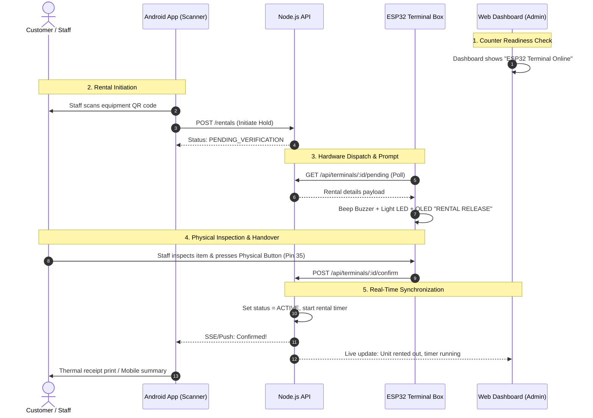

# RENT & PLAY: Master Presentation Flow & Analytics Defense Guide
**Laguna University — College of Computing Studies**  
**System:** *Rent & Play: An IoT-Integrated Equipment Rental and Due Date Management System with Mobile QR Scanning and ESP32 Counter Verification Terminal*  
**Target Enterprise:** Rent & Play, Lakewood Subdivision, Los Baños, Laguna (Manager: Reynold Pastor)

---

## 📌 Talaan ng Nilalaman
1. [Pangkalahatang Alituntunin at Setup Bago ang Presentation](#1-pangkalahatang-alituntunin-at-setup-bago-ang-presentation)
2. [Sunod-Sunod na Flow ng Presentation at Live System Demo](#2-sunod-sunod-na-flow-ng-presentation-at-live-system-demo)
   - [Phase 1: Opening & Problem Statement (1–2 mins)](#phase-1-opening--problem-statement-12-mins)
   - [Phase 2: System Architecture & Technical Stack (1–2 mins)](#phase-2-system-architecture--technical-stack-12-mins)
   - [Phase 3: Live End-to-End Demonstration (5–7 mins)](#phase-3-live-end-to-end-demonstration-57-mins)
   - [Phase 4: Operations, Maintenance & Audit Trail (2 mins)](#phase-4-operations-maintenance--audit-trail-2-mins)
   - [Phase 5: Centralized Analytics & Forecasting Deep-Dive (3–4 mins)](#phase-5-centralized-analytics--forecasting-deep-dive-34-mins)
   - [Phase 6: Conclusion & Transition to Q&A (1 min)](#phase-6-conclusion--transition-to-qa-1-min)
3. [Detalyadong Gabay sa Analytics Module (Para sa Panel)](#3-detalyadong-gabay-sa-analytics-module-para-sa-panel)
   - [Tab 1: Performance (Descriptive Analytics)](#tab-1-performance-descriptive-analytics)
   - [Tab 2: Forecasting (Predictive Analytics & Model Benchmarking)](#tab-2-forecasting-predictive-analytics--model-benchmarking)
   - [Tab 3: Recommendations (Prescriptive Analytics)](#tab-3-recommendations-prescriptive-analytics)
4. [Panel Q&A Cheat Sheet: Mga "Bitag" na Tanong at Handaang Sagot](#4-panel-qa-cheat-sheet-mga-bitag-na-tanong-at-handaang-sagot)

---

## 1. Pangkalahatang Alituntunin at Setup Bago ang Presentation

### A. Hardware & Device Checklist (15 minuto bago tawagin)
- [ ] **ESP32 Terminal Station:** Naka-plug sa power source, nakakonekta sa Wi-Fi access point (parehong Wi-Fi ng laptop/server), may display sa 128×64 OLED (`SYSTEM READY / STANDBY`), umiilaw ang indicator LED kapag nag-boot, at tumutunog ang test buzzer.
- [ ] **Android Phone (Staff / Customer Device):** May naka-install na updated APK mula sa `AndroidFiles`, gumagana ang camera para sa QR scanning, at naka-connect sa parehong local network o live backend URL.
- [ ] **Host Laptop (Presenter 1):** Naka-open ang Web Admin Dashboard (`http://localhost:5173` o production URL) sa Google Chrome / Edge.
- [ ] **Backend Server:** Tiyaking tumatakbo ang Node.js backend sa background (`apps/backend`) nang walang unhandled exceptions.
- [ ] **Physical Test Equipment:** Maghanda sa counter desk ng 1–2 test items na may nakadikit na printed QR codes (hal. *Badminton Set [R-101]*, *Monopoly Board Game [R-102]*).

### B. Role Delegation (Paghahati ng Salita)
| Tungkulin | Miyembro | Pangunahing Pokus |
| :--- | :--- | :--- |
| **Speaker 1 (Web & Architecture Lead)** | Presenter 1 | Rationale, Architecture, Web Dashboard, Rates, Financials, at Analytics. |
| **Speaker 2 (Mobile & Hardware Lead)** | Presenter 2 | Mobile App walkthrough, QR scanning, ESP32 terminal verification, at return inspection. |
| **Speaker 3 / Backup (QA & Data Lead)** | Presenter 3 | Audit logs, edge cases, fail-safe bypass demo, at tagasagot sa specific formula/code questions. |

---

## 2. Sunod-Sunod na Flow ng Presentation at Live System Demo

### Phase 1: Opening & Problem Statement (1–2 mins)
*Layunin: Ipakita agad sa panel kung anong tunay na negosyo ang tinutulungan at bakit kailangan ng teknolohiya.*

1. **Pagbati at Pagpapakilala:**
   > *"Magandang umaga po sa ating mga respetadong panel members. Kami po ang [Pangalan ng Grupo], at ngayong araw ay buong pagmamalaki naming ipiprisinta ang aming capstone project: **RENT & PLAY: An IoT-Integrated Equipment Rental and Due Date Management System with Mobile QR Scanning and ESP32 Counter Verification Terminal**."*
2. **Context ng Enterprise (Client):**
   > *"Ang aming beneficiary ay ang **Rent & Play**, isang equipment rental business sa Lakewood Subdivision, Los Baños, Laguna, na pinamamahalaan ni Mr. Reynold Pastor. Nagpaparenta sila ng sports gear, board games, at leisure equipment sa mga walk-in customers at mga vacationers sa mga private hot spring resorts."*
3. **Ang Problema (The Pain Points):**
   > *"Bago ang aming sistema, 100% mano-mano ang operasyon gamit ang papel na logbook. Nagdudulot ito ng tatlong malalaking problema:*
   > 1. *Mabagal na checkout at madalas na pagkakamali sa pagkwenta ng due dates at penalty fees.*
   > 2. *Hindi alam ng staff sa counter kung ang gamit ba ay available, rented, o nasa maintenance, kaya nagkakaroon ng double-booking.*
   > 3. *Kakulangan ng **pisikal na pruweba** sa counter — kapag software-only ang gamit, pwedeng ma-click ang 'Released' kahit wala pa ang gamit o customer sa counter."*

---

### Phase 2: System Architecture & Technical Stack (1–2 mins)
*Ipakita ang System Architecture Slide o Diagram.*

1. **Ang 5-Layer Integration:**
   > *"Upang masolusyunan ito nang buo, pinagsama namin ang limang layers:*
   > - *1. **Android Mobile App (Flutter):** Para sa portable QR scanning ng equipment at mabilisang inspeksyon.*
   > - *2. **Central REST API (Node.js/Express):** Ang nagpapatupad ng business rules, fee calculations, at security.*
   > - *3. **Supabase PostgreSQL and Storage:** Dito naka-save ang business records at media. Firebase Authentication ang ginagamit sa login; Firebase Cloud Messaging ang ginagamit sa push notifications.*
   > - *4. **Administrative Web Dashboard (React/Modern JS):** Para sa may-ari — inventory, rates, analytics, at staff monitoring.*
   > - *5. **ESP32 Counter Verification Terminal (IoT Layer):** Ang aming physical confirmation gate sa counter na may OLED, buzzer, alert LEDs, at physical push button."*

---

### Phase 3: Live End-to-End Demonstration (5–7 mins)
*Ito ang pinakamahalagang bahagi ng inyong defense. Sundin ang eksaktong sequence na ito.*



#### Hakbang 3.1: Equipment & Terminal Readiness Check (Web Screen)
- **Gawin:** Ipakita sa Web Dashboard na ang ESP32 Terminal ay may indicator na `🟢 ONLINE`. Ipakita rin ang Inventory list kung saan ang test unit (hal. *Badminton Set Unit 1*) ay nasa status na `AVAILABLE`.
- **Sasabihin:** 
  > *"Bago mag-release ng gamit, makikita sa ating Web Dashboard na active at nakikipag-ugnayan ang ating ESP32 terminal sa pamamagitan ng authenticated heartbeat."*

#### Hakbang 3.2: Walk-In Rental Request & QR Scanning (Android App)
- **Gawin:** Hawakan ang Android phone. Buksan ang camera scanner sa app at i-scan ang printed QR code sa equipment.
- **Makikita sa screen:** Agad lalabas ang pangalan ng gamit, rate, at customer selector. Piliin ang duration (hal. 2 Hours).
- **I-tap:** Pindutin ang button: **`[ ⚡ Verify on ESP32 Terminal ]`**.
- **Sasabihin:**
  > *"Sa pamamagitan ng camera ng smartphone, ini-scan ng staff ang physical QR code ng item. Pagka-tap ng 'Verify on ESP32 Terminal', inilalagay ng backend ang transaksyon sa status na `PENDING_VERIFICATION` at naglalagay ng 10-minute hold upang hindi ma-double book."*

#### Hakbang 3.3: Hardware Alert & Physical Handover Gate (ESP32 Terminal)
- **Gawin:** Ituro sa panel ang ESP32 countertop terminal box.
- **Makikita at Maririnig:**
  1. Tutunog ang buzzer (*Pip-Pip!*).
  2. Iilaw ang verification LED.
  3. Sa OLED screen, lilitaw ang:
     ```text
     ┌──────────────────────┐
     │   RENTAL RELEASE     │
     │ Ref: R-2026-001      │
     │ Badminton Set        │
     │ [PRESS BUTTON TO OK] │
     └──────────────────────┘
     ```
- **Ang Aksyon:** Ipakita ang pag-abot ng gamit, at pindutin ang **physical tactile push button** sa ESP32 box.
- **Sasabihin:**
  > *"Napansin po natin na agad nag-chime ang buzzer at nag-display sa OLED screen ang reference number at item name. Hindi magsisimula ang rental timer hangga't hindi napipindot ng staff ang physical push button sa counter matapos inspeksyunin ang gamit at iabot sa customer."*

#### Hakbang 3.4: Real-Time Handshake & Active Timer (All Screens)
- **Makikita:**
  - Sa **ESP32**: Magpapakita ng `CONFIRMED!` at tutunog ng success tone.
  - Sa **Mobile Phone**: Magco-close ang waiting modal at magpapakita ng `Transaction Confirmed!`. Pwedeng mag-trigger ng 58mm thermal receipt printing.
  - Sa **Web Dashboard**: Nang hindi nire-refresh ang browser, awtomatikong magiging `RENTED / ACTIVE` ang gamit at makikitang umaandar ang countdown timer at due date.
- **Sasabihin:**
  > *"Pagkatapos ma-confirm ng backend ang physical handoff, ina-update ang rental at ipinapadala ang update sa web at mobile. Ipapakita namin ang aktuwal na oras ng pag-update sa live demo; nakadepende ito sa network at device connectivity."*

#### Hakbang 3.5: Return Flow & Overdue Penalty Assessment
- **Gawin:** Kunin ulit ang Android phone (o gamitin ang Web Return Desk). I-scan ang parehong equipment QR code para sa return process.
- **Makikita:** Awtomatikong kukunin ng system ang active rental details, duration consumed, at kung may overdue fines.
- **Pindutin:** **`[ ⚡ Finalize Return via ESP32 ]`**.
- **Sa ESP32:** Magdi-display ang OLED ng `RETURN CONFIRM`, kasama ang status kung Good condition o may Overdue. Pindutin muli ang physical push button.
- **Resulta:** Magiging `COMPLETED` ang rental record, at babalik sa `AVAILABLE` status ang unit sa imbentaryo.
- **Sasabihin:**
  > *"Sa pagsauli, sinusuri ang kondisyon ng gamit at awtomatikong kinukwenta ng backend kung may overtime penalty base sa Philippine Standard Time. Ang huling pagtanggap ay muling kinukumpirma sa hardware terminal upang maibalik ang unit sa active stock."*

#### Hakbang 3.6: Fail-Safe / Anti-Stuck Guarantee (Emergency Bypass)
- **Gawin:** Ipakita sa screen ang link o switch na **`Manual confirm without hardware`**.
- **Sasabihin:**
  > *"Mayroon po kaming 'Anti-Stuck Guarantee'. Kung sakaling mawalan ng kuryente o Wi-Fi ang terminal station sa gitna ng dagsa ng customers, may authorization ang staff na mag-manual bypass. Ang transaksyon ay matutuloy pa rin, ngunit itatala sa Audit Trail na ito ay dumaan sa Authorized Manual Bypass."*

---

### Phase 4: Operations, Maintenance & Audit Trail (2 mins)
*Ipakita sa Web Dashboard:*
1. **Maintenance Management:** Ipakita kung paano i-flag ang sirang gamit (hal. putol na badminton string). Awtomatiko itong mawawala sa available rentals at magtatala ng maintenance downtime.
2. **Immutable Audit Logs:** Buksan ang Audit Trail. Ipakita na nakatala ang bawat galaw: petsa, oras, sinong user/staff ang nag-login, anong equipment ang hinawakan, at kung anong Terminal ID ang nag-confirm.

---

### Phase 5: Centralized Analytics & Forecasting Deep-Dive (3–4 mins)
*I-click sa sidebar ang **Reports → Business Analytics**.*  
*(Tingnan ang [Seksyon 3](#3-detalyadong-gabay-sa-analytics-module-para-sa-panel) para sa buong detalye ng sasabihin sa bawat tab).*

1. **Tab 1: Performance (Descriptive):** Ipakita ang Total Recorded Fees, Confirmed Rentals, Equipment Utilization, Weekday vs Hour Demand chart, at Terminal Verification Latency (Avg, Median, P95).
2. **Tab 2: Forecasting (Predictive & Benchmarking):** Ipakita ang demand projection gamit ang 4 models, ang Auto best-fit selection base sa lowest RMSE, at ang ±20% scenarios.
3. **Tab 3: Recommendations (Prescriptive):** Ipakita ang actionable insight cards (Overdue follow-up, Idle equipment review, Capacity planning) na nakabase sa totoong ebidensya at rules.
4. **Data Export:** Ipakita ang **Export analytics CSV** button na naglalaman ng buong filtered metrics at projections.

---

### Phase 6: Conclusion & Transition to Q&A (1 min)
*Buod ng mga nagawa at pormal na pagbubukas ng question and answer.*

> *"Sa kabuuan, matagumpay na natugunan ng **Rent & Play** ang lahat ng layunin ng pag-aaral:*
> 1. *Naalis ang manual pen-and-paper logs gamit ang modernong mobile QR scanning.*
> 2. *Naiwasan ang double-booking at inventory discrepancy sa pamamagitan ng automated business rules at pending hold.*
> 3. *Naitatag ang isang matibay na physical-to-digital validation checkpoint gamit ang ESP32 IoT Terminal.*
> 4. *At nabigyan ang management ng kumpletong 3-tier analytics suite para sa tamang pagpapasya sa negosyo.*
> 
> *Maraming salamat po, at bukas na po kami sa inyong mga katanungan at mungkahi."*

---

## 3. Detalyadong Gabay sa Analytics Module (Para sa Panel)

Ang analytics module ng Rent & Play ay hindi basta palamuting graphs. Ito ay nahahati sa tatlong antas ng business intelligence: **Descriptive**, **Predictive**, at **Prescriptive**.

```
┌────────────────────────────────────────────────────────────────────────┐
│                        RENT & PLAY ANALYTICS                           │
├───────────────────┬────────────────────────────┬───────────────────────┤
│  01. PERFORMANCE  │      02. FORECASTING       │  03. RECOMMENDATIONS  │
│    (Descriptive)  │ (Predictive & Benchmark)   │     (Prescriptive)    │
│  "Ano ang nangyari│   "Ano ang posibleng       │   "Ano ang dapat      │
│   sa operasyon?"  │    mangyari bukas?"        │    nating gawin?"     │
└───────────────────┴────────────────────────────┴───────────────────────┘
```

---

### Tab 1: Performance (Descriptive Analytics)

#### 1. Ang 4 Core KPI Cards (Itaas ng Screen)
* **Recorded Rental Fees:**
  - *Ano ito:* Ang kabuuang rental charges ng lahat ng `ACTIVE` at `COMPLETED` rentals sa loob ng napiling dates.
  - *Panel Note:* Ito ay **charges/fees**, hindi ito katumbas ng net income o verified cash collections dahil hiwalay ang cash box reconciliation sa rental agreements.
* **Confirmed Rentals:**
  - *Ano ito:* Bilang ng transaksyong matagumpay na na-confirm sa napiling date range.
* **Equipment Utilization (%):**
  - *Formula:* $\text{Utilization} = \frac{\text{Kabuuang Rented Hours}}{\text{Kabuuang Observed Calendar Hours}} \times 100$
  - *Bakit mababa ang porsyento (hal. 5%–15%)?* Dahil **24/7 calendar hours** ang denominator (kasama ang gabi at sarado ang shop), hindi business opening hours lang. Ito ang standard at tapat na sukatan sa asset management.
* **Repeat Customer Activity (%):**
  - *Formula:* Porsyento ng customers na umupa ng 2 o higit pang beses sa loob ng napiling period mula sa lahat ng nag-renta.

#### 2. Visual Charts & Trend Breakdown
* **Rental Fee / Activity Trend:**
  - Line chart na may switchable metric: **Rental fees (₱)** o **Rental counts**.
  - Pwedeng i-group sa **Daily**, **Weekly**, o **Monthly**.
  - May kasamang **Previous matched period comparison** (dashed blue line) upang makita kung tumaas o bumaba ang kita kumpara sa nakaraang linggo/buwan.
* **When Rentals Happen (Demand Heatmap):**
  - Switchable bar chart: **Weekday** (Lunes hanggang Linggo) o **Hour** (oras sa bawat araw).
  - *Gamit:* Tinutukoy kung anong araw (hal. Sabado at Linggo) at anong oras (hal. 2 PM – 6 PM) ang dagsa ng customer para makapaghanda ng sapat na staff.

#### 3. Equipment Rankings & Current Stock
* **Equipment Driving Results:**
  - Switchable view: **Most Rented** (ayon sa bilang ng renta) vs. **Highest Fees** (ayon sa kabuuang perang naipasok).
  - *Importanteng punto:* Pwedeng ang isang gamit ay madalas rentahan pero maliit ang kita (hal. Playing Cards), habang ang isa ay minsan lang rentahan pero malaki ang bayad (hal. Sound System).
* **Current Stock Availability Meter:**
  - Real-time snapshot ng kasalukuyang imbentaryo: Available, Rented, Reserved, at Under Maintenance. Independent ito sa piniling historical filter.

#### 4. Customers & Operations (Expandable Section)
* **On-Time Return Rate (%):**
  - *Formula:* $\frac{\text{Returns na naibalik sa oras o mas maaga}}{\text{Lahat ng natapos na returns sa period}} \times 100$
* **Late Rentals / Overdue Rate (%):**
  - *Formula:* $\frac{\text{Rentals na lumampas sa due date}}{\text{Lahat ng rentals na due sa period}} \times 100$
* **Average Rental Duration:** Karaniwang haba ng oras na hawak ng customer ang gamit mula checkout hanggang return.
* **Maintenance Downtime:** Kabuuang oras na naging unavailable ang kagamitan dahil sa pagkukumpuni o routine inspection.
* **Counter Confirmation Speed (ESP32 Station Performance):**
  - *Average:* Karaniwang tagal bago makumpirma ang request sa counter.
  - *Median:* Ang gitnang halaga (hindi apektado ng outliers).
  - *P95 (95th Percentile):* 95% ng mga transaksyon ay nakumpirma sa loob ng segundong ito. Sinusukat nito ang pinakamababagal na transaction sa counter upang makita kung may pila o bottleneck.

---

### Tab 2: Forecasting (Predictive Analytics & Model Benchmarking)

*Ito ang magpapabilib sa Panel dahil may scientific at statistical basis ang forecasting ng Rent & Play.*

#### 1. Ang Apat (4) na Time-Series Forecasting Models
| Model Name | Formula / Paraan | Kailan Epektibo? |
| :--- | :--- | :--- |
| **Seasonal Baseline (Weekday SMA)** | $\hat{Y}_t = \frac{1}{k} \sum Y_{t-i\cdot s}$ | Kinukuha ang average ng kaparehong araw ng linggo (hal. 4 nakaraang Sabado). Pinakamahusay kapag may malakas na weekend spike. |
| **Simple Exponential Smoothing (SES)** | $\hat{Y}_{t+1} = \alpha Y_t + (1-\alpha)\hat{Y}_t$ <br>*(gamit ang $\alpha = 0.35$)* | Mas binibigyan ng bigat ang mga pinakabagong araw. Mahusay kapag walang matinding seasonal pattern pero nagbabago ang demand level. |
| **Weighted Moving Average (WMA)** | $\hat{Y}_{t+1} = \frac{\sum w_i Y_i}{\sum w_i}$ | 7-day window kung saan mas malaki ang timbang ng kahapon kaysa noong isang linggo. |
| **Linear Regression (OLS Trend)** | $\hat{Y}_t = \max(0, a + b\cdot t)$ | Ordinary Least Squares line. Sinusukat kung pangkalahatang pataas (growth) o pababa (decline) ang takbo ng negosyo. |

#### 2. Auto Best-Fit Selection & Walk-Forward Validation
* **Paano pumipili ang system ng Best Model?**
  - Hindi nanghuhula ang system. Gumagamit ito ng **Walk-Forward Holdout Validation**.
  - Sinusubok ng system ang bawat modelo sa mga nakalipas na araw (held-out actual data) kung saan tanging mas lumang datos lamang ang alam ng modelo.
  - Ang modelong may **pinakamababang RMSE (Root Mean Square Error)** at **MAE (Mean Absolute Error)** ang awtomatikong binibigyan ng star (`★ Best Fit`).
* **Fit Score (Accuracy Metric):**
  - $\text{Fit Score} = \max(0, 1 - \text{WAPE})$. Sinusukat nito kung gaano kalapit ang forecast sa actual totals (100% ang perpekto).
* **SMAPE (Symmetric Mean Absolute Percentage Error):**
  - Standard percentage error metric na hindi nag-di-divide by zero kapag walang renta sa isang araw.

#### 3. Planning Scenarios & Equipment Mix
* **Scenarios:** May toggle para sa **Lower (-20%)**, **Baseline (Expected)**, at **Higher (+20%)** upang makapagplano ang may-ari sa worst-case at best-case scenarios.
* **Projected Equipment Mix:** Hinahati ang tinatayang demand base sa historical market share ng bawat kagamitan (hal. kung 40% ng demand noon ay Basketball, 40% din ng projected rentals ang ilalaan dito).
* **Tapat na Datos (Data Integrity):**
  - Kung kulang ang historical days (kailangan ng 28 complete days para sa daily, 8 weeks para sa weekly), tapat na sasabihin ng screen: **`More history needed`**. Hindi ito gagawa ng pekeng estimates.
  - Hindi isinasama ang kasalukuyang araw ("Today is partial") sa pag-train upang hindi masira ang accuracy.

---

### Tab 3: Recommendations (Prescriptive Analytics)

*Dito sinasagot ng system: "Ngayong alam na natin ang datos, anong aksyon ang dapat gawin ng shop owner?"*

Lahat ng recommendations ay **Rule-Based** at may malinaw na **Evidence**. Hindi ito random text.

| Rekomendasyon | Trigger Rule (Kailan Lumalabas?) | Evidence at Aksyon |
| :--- | :--- | :--- |
| **Overdue Follow-Up** *(High Priority)* | Kapag may 5+ completed rentals sa period at ang Overdue Rate ay $\ge 20\%$. | **Evidence:** X rentals ang naibalik nang huli. <br>**Action:** Repasuhin ang paalala sa SMS/chat bago ang due date o dagdagan ang security deposit. |
| **Terminal Handoff Review** *(High Priority)* | Kapag may 5+ terminal confirmations at ang P95 speed ay $\ge 60$ segundo. | **Evidence:** 95% ng confirmations ay lumagpas sa 1 minuto. <br>**Action:** Suriin ang counter placement ng ESP32 o turuan ang staff na agad pindutin ang button pagkatapos ng physical check. |
| **Service & Repair Review** *(Medium Priority)* | Kapag ang isang item ay nagkaroon ng 2 o higit pang maintenance records sa period. | **Evidence:** Paulit-ulit na pagkasira ng unit. <br>**Action:** Isaalang-alang kung papalitan na ang piyesa o buong gamit. |
| **Capacity Review (Dagdag Stock)** *(Medium Priority)* | Kapag ang item ay may 3+ rentals at nasa top 25% pinakamaraming renta. | **Evidence:** Mataas na demand at madalas maubos ang available stock. <br>**Action:** Magdagdag ng unit sa susunod na inventory purchase. |
| **Idle Equipment / Listing Review** *(Monitor)* | Kapag ang item ay zero (0) rentals sa loob ng 30+ araw habang ang ibang gamit ay may 5+ rentals. | **Evidence:** Walang pumapansin sa gamit sa loob ng isang buwan. <br>**Action:** Ilagay sa prominenteng display sa shop, babaan ang rental rate, o i-bundle sa ibang items. |

> **Crucial Rule for Defense:** Ang recommendations ay **advisory lamang**. Hindi ito awtomatikong nagbabago ng presyo sa database nang walang approval ng may-ari.

---

## 4. Panel Q&A Cheat Sheet: Mga "Bitag" na Tanong at Handaang Sagot

### Kategorya 1: IoT & Hardware Integration

#### ❓ Q1: "Bakit kailangan pa ng ESP32 hardware terminal kung kaya namang pindutin ang 'Confirm' sa mobile app o web dashboard?"
> **💡 Sagot:**  
> *"Ang pure software system po ay 'blind' sa pisikal na kaganapan sa counter. Sa isang abalang rental shop, maaaring pindutin ng staff ang 'Release' sa phone kahit hindi pa personal na naiinspeksyon ang gamit o kahit wala pa ang customer sa harap ng counter.*  
> *Ang ESP32 Counter Terminal ay nagsisilbing **authoritative physical confirmation gate**. Pinipilit nito na bago magsimula ang rental timer sa database, dapat ay personal na hawak ng staff ang kagamitan sa counter at pipindutin ang pisikal na push button. Tinitiyak nito ang accountability at pinipigilan ang accidental state changes."*

#### ❓ Q2: "Bakit HTTP REST API polling ang ginamit sa ESP32 at hindi MQTT o WebSockets?"
> **💡 Sagot:**  
> *"Pinili po namin ang authenticated HTTP REST dahil sa tatlong praktikal na dahilan:*  
> *1. **Simplicity and Unified Architecture:** Iisa lang ang REST backend server para sa Web, Mobile, at ESP32. Hindi na kailangan ng hiwalay na external MQTT broker instance tulad ng Mosquitto.*  
> *2. **Lightweight Polling:** Ang 3-second polling interval ng ESP32 ay napakagaan sa local server at sapat na sapat sa counter workflow ng isang rental shop.*  
> *3. **Reliable Two-Way State Handshake:** Mas madaling mag-implement ng stateless HMAC/Bearer authentication at deterministic error handling sa REST payloads."*

#### ❓ Q3: "Nasaan ang sensors sa sistema ninyo ayon sa IoT definition?"
> **💡 Sagot:**  
> *"Mayroon po kaming dalawang lebel ng sensing at input actuation:*  
> *1. **Optical Image Sensor:** Ang CMOS camera sensor ng mobile device ay ginagamit para sa optical QR scanning at decoding ng serialized equipment labels.*  
> *2. **Tactile Hardware Sensing & Actuation:** Ang hardware push button na nakakonekta sa GPIO 35 na may active-low hardware interrupt sa ESP32 ang pisikal na contact trigger, habang ang output actuation ay ginagampanan ng SSD1306 I2C OLED display, status indicator LEDs, at acoustic buzzers."*

---

### Kategorya 2: Business Logic & Data Integrity

#### ❓ Q4: "Bakit kapag pinagsama ang On-Time Return Rate at Overdue Rate, hindi ito eksaktong 100%?"
> **💡 Sagot:**  
> *"Dahil magkaiba po ang **cohort o denominator** ng dalawang sukatan:*  
> *- Ang **Overdue Rate** ay nakabase sa **DUE DATES** ng mga rentals sa napiling period (ilang rentals ang dapat sanang naibalik sa period na ito ngunit na-late).*  
> *- Ang **On-Time Rate** naman ay nakabase sa **RETURN DATES** ng mga aktwal na naisauli (sa mga naibalik ngayong period, ilan ang pasok sa oras).*  
> *Halimbawa po: Ang gamit na due noong nakaraang buwan ngunit isinauli ngayong buwan ay mabibilang sa Return cohort ngayon, pero wala sa Due cohort ng kasalukuyang buwan. Ang paghihiwalay na ito ay sumusunod sa standard mathematical accounting principles."*

#### ❓ Q5: "Ang 'Recorded Rental Fees' ba sa Performance tab ay katumbas na ng Net Profit o Revenue ng negosyo?"
> **💡 Sagot:**  
> *"Hindi po. Ang Recorded Rental Fees ay sumusukat lamang sa **kabuuang charges o sinisingil sa rental contracts**. Hiwalay po ito sa cash collections, GCash payments, operational expenses (tulad ng maintenance), at security deposit refunds.*  
> *Sa aming system, may hiwalay na 'Cash & Collections' breakdown para sa physical cash flow upang hindi malito ang pamunuan sa pagitan ng sinisingil (accrual) at aktwal na perang hawak sa kaha (cash basis)."*

#### ❓ Q6: "Bakit napakababa ng Equipment Utilization (halimbawa 10% hanggang 20% lang)?"
> **💡 Sagot:**  
> *"Mababa po ito dahil ang ginagamit naming denominator ay **buong calendar hours (24 oras bawat araw)** simula nang maipasok ang item sa imbentaryo, hindi lamang ang 8 o 10 oras na bukas ang tindahan.*  
> *Kung ang isang badminton racket ay inupahan ng 4 na oras sa isang araw, ang utilization nito ay $4 \div 24 = 16.6\%$. Ito po ang tapat at standard na engineering calculation ng asset utilization upang malaman ng may-ari kung gaano katagal talagang nakatiwangwang ang asset sa loob ng 24 oras."*

#### ❓ Q7: "Bakit may mga dash (`—`) sa ilang fields sa analytics?"
> **💡 Sagot:**  
> *"Ang gitling (`—`) ay nangangahulugang **insufficient or unmeasured valid data**, at hindi ito katumbas ng zero.*  
> *Halimbawa, kung zero ang completed returns sa napiling linggo, hindi pwedeng sabihing 0% ang On-Time Rate dahil magkakaroon ng division by zero ($0 \div 0$). Sa halip na magpakita ng maling numero, nagpapakita ang system ng dash kasama ang eksplenasyon sa 'Data Coverage & Measurement Notes' upang mapanatili ang integridad ng datos."*

---

### Kategorya 3: Forecasting & Machine Learning

#### ❓ Q8: "Bakit apat (4) ang forecast models ninyo at bakit hindi na lang Deep Learning / Neural Networks ang ginamit?"
> **💡 Sagot:**  
> *"Para sa small-to-medium rental enterprises, ang kumplikadong Neural Networks tulad ng LSTM ay madaling kapitan ng **overfitting** dahil limitado pa ang volume ng transaksyon, bukod sa nangangailangan ito ng mabigat na GPU server.*  
> *Gumamit kami ng apat na subok na statistical time-series models (Seasonal SMA, SES, WMA, at Linear Regression) dahil:*  
> *1. **Interpretability:** Malinaw sa panel at sa business owner kung paano nakuha ang numero gamit ang simpleng mathematical formulas.*  
> *2. **Benchmarking:** Nagpapatakbo ang system ng holdout walk-forward validation kung saan ang modelong may pinakamababang RMSE ang awtomatikong pinipili bilang 'Best Fit'.*  
> *3. **Computational Efficiency:** Mabilis itong makalkula sa browser at backend nang walang lag."*

#### ❓ Q9: "Bakit kapag kulang ang records ay ayaw magpakita ng forecast ang system?"
> **💡 Sagot:**  
> *"Sinadya po naming ilagay ang mahigpit na validation rule (kailangan ng hindi bababa sa 28 complete days para sa daily forecast). Ang responsableng software engineering ay hindi dapat nagpapakita ng 'hallucinated' o gawa-gawang predictions kapag kulang ang historical training samples. Kapag kulang ang datos, tapat na ipinapaliwanag ng system kung ilang araw pa ang kailangang maitala bago maging statistically reliable ang forecast."*

---

### Kategorya 4: Security, Access Control & Fail-safes

#### ❓ Q10: "Paano ninyo pinipigilan ang panloloko o pag-hack sa mobile app o API?"
> **💡 Sagot:**  
> *"Ipinapatupad namin ang multi-layered defense:*  
> *1. **Role-Based Access Control (RBAC):** May 4 roles: `OWNER`, `OPERATOR`, `CUSTOMER`, at `DEVICE`. Ang customer account ay binibigyan ng `403 Forbidden` kapag sinubukang mag-login sa web admin.*  
> *2. **Server-Side Pricing Engine:** Ang rental rates at overdue penalties ay kinakalkula **eksklusibo sa backend**. Walang kakayahan ang mobile app na diktahan ang presyo.*  
> *3. **Pre-Shared Bearer Token:** Ang ESP32 ay may unique provisioned key na pinapayagan lamang ma-access ang `/pending` at `/confirm` endpoints.*  
> *4. **Short-Lived Verification TTL:** Ang bawat pending rental request ay may 10-minute validity lamang. Kung hindi ito mapindot sa physical terminal sa loob ng 10 minuto, kusa itong kinakansela ng system upang hindi mabimbin ang gamit."*

#### ❓ Q11: "Paano kung masira ang ESP32 o mag-offline ang Wi-Fi sa araw ng rush hour?"
> **💡 Sagot:**  
> *"Mayroon kaming **Emergency Manual Bypass**. Sa parehong mobile app at web rental desk, may nakalaang authorized override button: `Manual confirm without hardware`. Papayagan nitong matuloy ang pag-renta o pagsauli upang hindi maabala ang customer, ngunit agad itong magtatala ng entry sa Audit Trail na minarkahang 'MANUAL BYPASS' kasama ang pangalan ng staff para sa pananagutan."*

---

## 🎯 Final Tips para sa Araw ng Defense
1. **Maging Kalmado:** Bago magsimula, tiyaking nakatutok ang camera o web screen kung saan kitang-kita ng panel ang ESP32 OLED display.
2. **Huwag Mag-Overpromise:** Kung may itanong ang panel na wala sa saklaw (hal. GPS live tracking sa buong Laguna o mechanical automated vending machine), sumagot nang tapat: *"Magandang suggestion po iyan for future enhancement; sa kasalukuyang scope po namin, nakapokus kami sa shop counter physical verification at due-date management para sa Lakewood Subdivision."*
3. **Laging Ituro ang Ebidensya:** Kapag tinanong tungkol sa numbers sa analytics, i-click ang **"How these metrics are measured"** o ang **"Data coverage"** tab upang makita ng panel na may matibay na mathematical framework ang inyong sistema.
