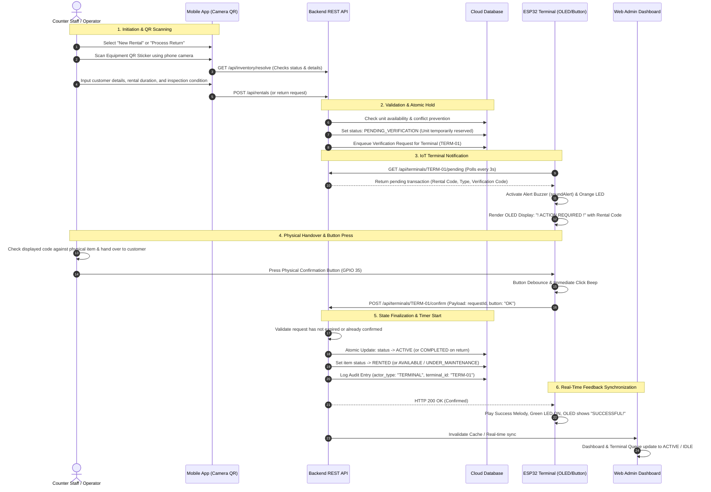

# REVISED CAPSTONE PROJECT PROPOSAL
**Laguna University — College of Computing Studies**  
*Laguna Sports Complex, Brgy. Bubukal, Sta. Cruz, Laguna*

---

## PROPOSED PROJECT TITLE
**RENT & PLAY: An IoT-Integrated Equipment Rental and Due Date Management System with Mobile QR Scanning and ESP32 Counter Verification Terminal**

*Alternative Academic Titles:*
1. **Rent & Play: Web and Mobile Equipment Rental System with ESP32-Assisted Counter Verification Station**
2. **IoT-Assisted Rental and Return Verification Terminal with Mobile QR Code Scanner and Centralized Web Dashboard for Rent & Play**

---

## I. PROJECT OVERVIEW AND RATIONALE

**Rent & Play** is an equipment rental business located in **Lakewood Subdivision, Los Baños, Laguna**, managed by **Reynold Pastor**. The business caters to both walk-in customers and vacationers staying at private hot spring resorts within the subdivision. Its inventory includes sports gear (basketballs, volleyballs, badminton sets), board games, card games, and entertainment equipment.

### The Verified Problem
The existing operational setup relies on manual, paper-based logbooks, manual customer record verification, and ad-hoc communication. This introduces notable operational bottlenecks:
1. **Manual Logging & Inaccuracy:** Rental start times, due dates, customer contact information, and equipment condition snapshots are handwritten, leading to human error, missed returns, or uncollected late fees.
2. **Ambiguous Equipment Availability:** Staff cannot instantly confirm whether an item is currently available, rented out, reserved, or undergoing maintenance.
3. **Lack of Tangible Transaction Verification:** When staff or customers initiate a rental or return, there is no dedicated physical hardware checkpoint at the shop counter to independently confirm that the transaction was legally registered in the database, that physical inspection occurred, and that the item was physically handed over.
4. **Vulnerability to Accidental or Untracked State Changes:** Pure software buttons on web browsers or mobile apps can be clicked erroneously without staff being physically present at the inventory counter with the item in hand.

### The Proposed Solution
To directly address these challenges and fulfill the academic requirements, the project integrates five unified system layers:
1. **Cross-Platform Mobile Application (Android/Flutter):** Acts as the portable operational tool. Staff or customers scan equipment QR codes using the smartphone camera to initiate rental and return transactions on the spot.
2. **Centralized Backend REST API (Node.js):** Orchestrates business logic, validates inventory availability, calculates rental fees and overdue penalties, manages state transitions, and enforces security.
3. **Cloud Database (Firebase Firestore / Supabase):** Serves as the single source of truth for inventory items, customer profiles, rental records, condition history, and audit logs.
4. **Administrative Web Dashboard:** Provides the business owner with complete management capabilities over rates, inventory, analytics, maintenance tracking, and real-time terminal monitoring.
5. **ESP32-Assisted Counter Verification Terminal (IoT Station):** A dedicated countertop device equipped with an **OLED display**, **LED indicators**, **active and passive buzzers**, a **tactile push button**, and **Wi-Fi API integration**.

### The Role of the ESP32 Terminal
The ESP32 is **not a passive display**. It functions as an **authoritative physical confirmation gate**:
* When a rental or return is initiated from the mobile application (or web counter desk), the system creates a transaction in a `PENDING_VERIFICATION` state and places a temporary hold on the inventory item.
* The ESP32 polls the backend API over Wi-Fi, detects the pending request, displays the transaction type (`RENTAL RELEASE` or `RETURN CONFIRM`) and reference code on its OLED screen, and sounds an audible buzzer chime while illuminating its alert LED.
* The staff physically inspects the equipment, verifies the customer, and presses the **physical push button** on the ESP32 terminal.
* The ESP32 transmits a cryptographically authenticated confirmation payload back to the backend API over Wi-Fi.
* Only upon receiving this physical button press does the backend mark the transaction as `CONFIRMED` / `ACTIVE`, start the rental timer (or stop overtime on return), and record an immutable audit log linking the terminal ID and timestamp.

---

## II. STATEMENT OF THE PROBLEM

### General Problem
How can Rent & Play streamline its equipment rental and return processes by eliminating paper-based logs, preventing inventory status discrepancies, and establishing a secure, physically confirmed transaction workflow using mobile QR scanning, a centralized web dashboard, and an ESP32-assisted IoT verification terminal?

### Specific Problems
1. **Inefficient Manual Logging & Verification Delays:**  
   Manual pen-and-paper tracking causes slow checkout and check-in times, risks missing contact data, and complicates overtime penalty calculations.
2. **Uncertain Equipment Availability and Custody:**  
   Without real-time inventory synchronization, staff struggle to verify whether an item is available, rented, out for delivery, or in maintenance, risking double-booking.
3. **Absence of Immediate Physical Confirmation at the Counter:**  
   Purely digital transactions lack immediate tangible and audible confirmation at the physical handover counter, leaving room for discrepancies between what is logged on screen and what is physically transferred.
4. **Lack of Hardware-Enforced Anti-Tamper & Error Handling:**  
   Without a dedicated hardware verification step, records can be prematurely marked as released or returned without staff physical presence. Furthermore, network timeouts, duplicate confirmation attempts, and expired holds are not systematically handled.

---

## III. PROJECT OBJECTIVES

### General Objective
To design, develop, and integrate a web dashboard, mobile application, central backend REST API, cloud database, and an **ESP32-assisted rental and return verification terminal** for Rent & Play that centralizes inventory management, automates due-date and fee calculations, and ensures that equipment handovers are physically validated through mobile QR scanning and hardware button confirmation.

### Specific Objectives
1. **Mobile QR Scanning & Transaction Initiation:**  
   Develop a mobile application module that uses the device camera to scan unique equipment QR codes and initiate rental or return requests directly from the field or counter.
2. **Real-Time Inventory & Business Rule Automation:**  
   Implement a backend REST API that validates unit availability, enforces rental policies, computes duration-based or package fees and overdue penalties, and locks inventory in a `PENDING_VERIFICATION` state to prevent race conditions.
3. **ESP32 Counter Verification Terminal (Hardware Layer):**  
   Construct an IoT terminal using an ESP32 microcontroller with:
   * A **128×64 OLED display** (SSD1306) to show transaction type, rental code, and verification status.
   * **Dual LEDs and Buzzers** to provide immediate audible chimes and visual cues for incoming requests, successful confirmations, and system errors.
   * A **tactile push button** (GPIO 35) as a physical confirmation trigger.
   * **Wi-Fi API integration** to poll pending requests and submit authenticated confirmation payloads to the backend.
4. **Physical-to-Digital Handshake Synchronization:**  
   Ensure that no rental is activated (and no return is finalized into inventory) until the physical button on the ESP32 terminal is pressed and accepted by the backend API.
5. **Administrative Web Management & Audit Tracking:**  
   Develop an administrative web workspace allowing the owner/operator to manage inventory, configure pricing rates, monitor active rentals and approaching due dates, track maintenance, and view an audit trail of all terminal verification attempts.

---

## IV. SCOPE, LIMITATIONS, AND EXCLUSIONS

### In-Scope
* **Central Inventory Management:** Digital cataloging of board games, sports equipment, and accessories with unique QR labels, condition ratings, and maintenance logs.
* **Mobile QR Workflow:** Scanning printed QR labels on physical equipment to initiate release or return.
* **ESP32 Verification Station:** Dedicated countertop terminal communicating over Wi-Fi REST API, utilizing OLED, push button, buzzers, and status LEDs for physical transaction confirmation.
* **Rate & Overtime Engine:** Configurable hourly, package, and whole-stay rental rates with automated overtime penalty computation.
* **Audit Trail & Terminal Logging:** Persistent tracking of terminal IDs, verification timestamps, inspector identities, and hardware confirmation statuses.
* **Web Dashboard:** Full administrative interface for business reporting, rate configuration, and real-time terminal queue monitoring.

### Limitations & Exclusions (Out-of-Scope)
* **Automated Physical Dispensing:** The ESP32 terminal serves as an electronic verification gate and notification kiosk; it does not mechanically dispense or lock equipment inside physical lockers.
* **GPS Tracking:** The system does not track the real-time physical location of equipment outside the Lakewoods Subdivision perimeter.
* **Third-Party Payment Gateway Automation:** Payments are recorded via Cash or verified InstaPay QR screenshots manually confirmed by staff; automated bank payment gateway webhooks are out of scope.
* **Cellular GSM/GPRS Communication:** The ESP32 terminal operates over standard 2.4 GHz local Wi-Fi provided at the Rent & Play establishment.

---

## V. PROPOSED INTEGRATED WORKFLOW



---

## VI. PLATFORM RESPONSIBILITY MATRIX

| System Component | Primary Role & Responsibility | Key Inputs | Key Outputs |
| :--- | :--- | :--- | :--- |
| **Mobile Application (Flutter)** | On-site transactional workflow tool. Scans physical equipment QR codes, captures release/return inspection details, and initiates requests. | Phone camera QR scan, staff form input, customer selection. | Equipment ID lookup, structured rental/return payload to Backend API. |
| **ESP32 Verification Terminal** | Fixed countertop IoT verification station. Visually and audibly notifies counter staff of pending handovers, and serves as the physical confirmation gate via hardware button. | Wi-Fi polling response from API, physical button press (GPIO 35). | OLED visual display, audible buzzer feedback, LED status indicators, HTTP POST confirmation payload. |
| **Backend REST API (Node.js)** | Central business logic controller. Manages security, rate quoting, transaction validation, race condition prevention, and hardware authentication. | HTTP requests from Mobile, Web, and ESP32. | JSON responses, terminal authorization, database transaction writes, audit trail logs. |
| **Cloud Database (Firestore / Supabase)** | Unified persistence layer and single source of truth for all platforms. | Atomic read/write transactions executed by Backend API. | Persistent records of items, customers, rentals, condition snapshots, and verification logs. |
| **Web Dashboard (Admin)** | Management, reporting, and operational monitoring console. Used by the business owner for inventory, pricing, analytics, and terminal status monitoring. | Administrative input, filter selections, real-time sync queries. | Inventory controls, rate sheets, financial summaries, overdue warnings, and live terminal queue display. |

---

## VII. ESP32 HARDWARE SPECIFICATION & PINOUT PLAN

### Hardware Bill of Materials (BOM)
* **Microcontroller:** ESP32-WROOM-32 Development Board (240 MHz Dual-Core, 2.4 GHz Wi-Fi)
* **Visual Display:** 0.96-inch I2C OLED Display (SSD1306 driver, 128×64 resolution, 3.3V)
* **Manual Input:** Tactile Momentary Push Button with internal pull-up resistor
* **Auditory Feedback:** 
  * 1× 5V Active Buzzer (for sharp alert beeps and tactile click confirmation)
  * 1× Passive Buzzer (driven via PWM tone generation for custom startup, success, and error chimes)
* **Visual Status Indicators:**
  * 1× Amber/Red Status LED (indicates pending action or system warning)
  * 1× Green Status LED (indicates successful confirmation and idle ready state)

### GPIO Pinout Mapping
| Hardware Peripheral | ESP32 GPIO Pin | Electrical Configuration | Operational Purpose |
| :--- | :--- | :--- | :--- |
| **OLED SDA** | GPIO 21 | I2C Data Line | Sends text, graphics, and transaction codes to OLED |
| **OLED SCL** | GPIO 22 | I2C Clock Line | Synchronizes I2C communication (400 kHz) |
| **Push Button** | GPIO 35 | Input with `INPUT_PULLUP` (Active LOW) | Senses user press to authorize physical handover |
| **Active Buzzer** | GPIO 32 | Digital Output | Emits sharp audible clicks upon button depression |
| **Passive Buzzer** | GPIO 23 | PWM Output (`tone()`) | Plays multi-frequency startup, alert, and success tunes |
| **Status LED 1 (Alert)** | GPIO 27 | Digital Output (Active HIGH) | Lights up when a verification request is pending |
| **Status LED 2 (Success)** | GPIO 14 | Digital Output (Active HIGH) | Flashes on successful confirmation |

### Terminal Firmware State Machine
```
[BOOT] -> [CONNECTING_WIFI] -> [STATE_IDLE]
                                     |
                                (Polls API)
                                     v
                       [STATE_PENDING_CONFIRMATION]
                       (OLED Code, Buzzer, Alert LED)
                                     |
                          (Button Press Trigger)
                                     v
                            [STATE_CONFIRMING]
                         (Sending POST to Backend)
                                     |
                   +-----------------+-----------------+
                   |                                   |
                   v                                   v
          [STATE_SUCCESS]                       [STATE_ERROR]
      (Success Chime, Green LED)             (Error Buzz, Red LED)
                   |                                   |
                   +----------------> [STATE_IDLE] <---+
```

### Offline & Error Handling Rules
1. **Wi-Fi / API Loss:** If Wi-Fi disconnects or the backend server is unreachable, the OLED immediately displays `"Wi-Fi Disconnected / Server Error"` and the red LED illuminates. The terminal **never confirms transactions locally** without backend authorization.
2. **Hold Expiration:** Verification requests carry a strict time-to-live (e.g. 10 minutes). If staff does not press the button within this window, the backend expires the hold and clears the item reservation. When the ESP32 next polls, it automatically reverts to `STATE_IDLE`.
3. **Duplicate Press Prevention:** Software debouncing (40 ms) and atomic backend transaction locks prevent accidental double-clicks from sending duplicate confirmation requests.

---

## VIII. PRELIMINARY API CONTRACT

### 1. Terminal Pending Queue
* **Endpoint:** `GET /api/terminals/{terminalId}/pending`
* **Headers:** `Authorization: Bearer <TERMINAL_SECRET_KEY>`, `Accept: application/json`
* **Response (Pending State):**
  ```json
  {
    "terminal_id": "TERM-01",
    "requests": [
      {
        "id": "req_8f1a2c3d",
        "rental_code": "R-10024",
        "transaction_type": "RENTAL",
        "verification_code": "V-5521",
        "inspection_revision": 1,
        "expires_at": "2026-10-18T14:45:00.000Z"
      }
    ]
  }
  ```

### 2. Terminal Transaction Confirmation
* **Endpoint:** `POST /api/terminals/{terminalId}/confirm`
* **Headers:** `Authorization: Bearer <TERMINAL_SECRET_KEY>`, `Content-Type: application/json`
* **Payload:**
  ```json
  {
    "requestId": "req_8f1a2c3d",
    "action": "CONFIRM",
    "button": "OK",
    "verificationCode": "V-5521",
    "inspectionRevision": 1
  }
  ```
* **Response:**
  ```json
  {
    "id": "req_8f1a2c3d",
    "status": "CONFIRMED",
    "rental_id": "booking_99a81",
    "item_status": "RENTED",
    "confirmed_at": "2026-10-18T14:36:12.140Z"
  }
  ```

---

## IX. CLIENT VALUE AND SUCCESS INDICATORS

| Project Aspect | Current Baseline (Paper-Based) | Proposed Target with ESP32 & Mobile QR |
| :--- | :--- | :--- |
| **Equipment Identification** | Searching through paper sheets or manual text lookup. | Immediate mobile camera QR scan resolves exact equipment ID within 2 seconds. |
| **Handover Validation** | Handwritten note; no timestamp verification. | Dual-channel confirmation: staff mobile input verified by physical ESP32 counter button press. |
| **Due Date & Penalty Tracking** | Mental arithmetic or manual clock watching; frequent fee discrepancies. | Automated backend quote engine calculating precise minutes, grace periods, and late penalties. |
| **Hardware Counter Feedback** | No connected devices at the counter. | ESP32 sounds alert buzzer, displays transaction code on OLED, and provides visual LED confirmation. |
| **Audit & Record Integrity** | Easily lost or torn logbook pages. | Cloud database audit trail logging terminal ID (`TERM-01`), timestamp, inspector, and condition photos. |
