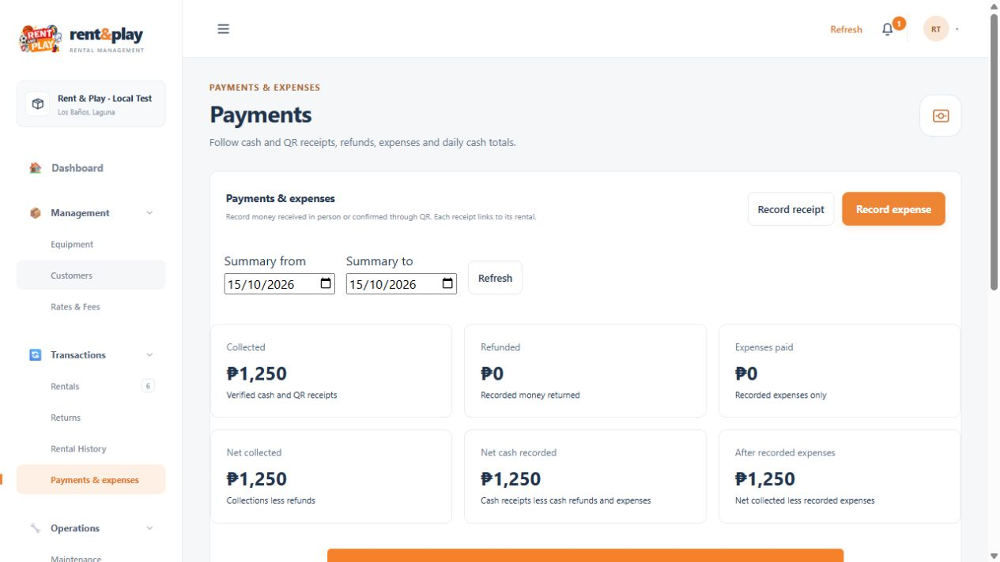
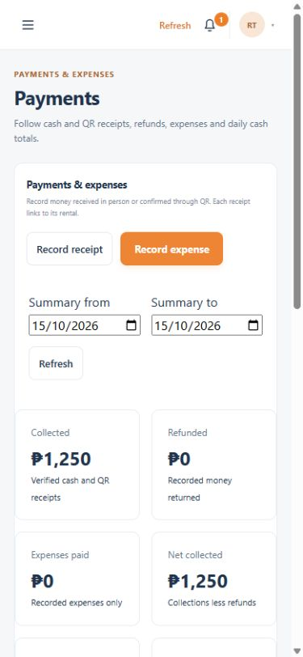

# Local planning and payments verification — 15 October 2026

Latest verification: [web, Android and backend audit](system-audit-2026-10-15.md). Use that report for current test counts, inventory and Android build evidence; this document records the earlier feature delivery.

The approved changes are implemented in the shared backend, web workspace and Android application. Delivery stays within Lakewood Subdivision, Los Baños, Laguna. Cash is accepted in person; staff record actual receipts. QR transfers remain manually verified. ESP32 stays on standby.

## Delivered behavior

- Customers and staff can rent now or choose a future date/time. Availability covers the full interval with a ten-minute return/inspection allowance. Future reservations do not unnecessarily occupy current stock. Preparation verifies the exact unit and opens only within ten minutes before the planned start; the rental clock starts at physical handoff.
- The local delivery plan has a Manila day filter. Staff record preparation, departure, delivery or an unsuccessful attempt with operator/time evidence. Failed delivery retains custody until the exact unit is physically received back at the shop. Damaged returns create maintenance for that unit; refunds remain separate.
- Customers can request additional time after reviewing the price. Staff can assist walk-in customers after confirming their agreement. Approval checks the following reservation again, updates the due time and outstanding charges, and does not invent a collection. Persistent retry records prevent older requests from charging again after later extensions.
- Payments & expenses records partial/balance cash or verified QR receipts, rental refunds and expenses already paid. Public PAY references are saved once and shared by both clients. Daily cash movement, net collections and recorded expenses are separate from assessed charges. Posting a receipt cannot approve or start a rental.
- Rental, customer and maintenance history uses backend filters and cursors, normally 25 records and at most 100 per page. Customer lookup reaches beyond the first loaded page. Dashboard/report charge totals and customer counts are precomputed, with persisted projection jobs for retry.
- Safe metadata normalization preserves IDs, QR values and financial evidence. ID-requirement acknowledgement now uses an accurate field, with compatibility for older Android clients. Physical identity is still checked by staff at handoff.

Full business rules: [local planning and payments](../architecture/local-planning-and-payments.md). Requests and filters: [endpoints](../api/endpoints.md) and [OpenAPI](../../packages/api-contracts/openapi/openapi.yaml).

## Final verification

| Check | Result |
| --- | --- |
| Backend suite | 189 passed, zero failures or skips; local Firestore emulator included |
| Web suite | 166 passed, zero failures or skips |
| Android suite | 74 passed |
| Total automated tests | 429 passed |
| Flutter analyzer | No issues found |
| Web syntax checks and production build | Passed, including all three new browser modules |
| OpenAPI | Valid YAML, version 0.5.0; 55 paths, 26 schemas, 57 resolved local references |
| Live Firebase query checks | Seven supported query checks passed; bounded pages and three existing daily charge summaries verified |
| Cloud query indexes | All 42 configured indexes present, none building |
| Live catalog consistency | 16 active physical units in 14 equipment groups; group IDs, stock and scanned unit IDs agree; all 14 groups have configured rental rates |
| Restarted backend | HTTP 200 health; Firebase database healthy, project `rent-and-play` |
| Web API proxy | HTTP 200 catalog with 14 groups |
| New web page/assets | `/payments` and finance, planning and report-payment modules returned HTTP 200 |
| ESP32 | Live pending poll returned HTTP 409 with the standby message |
| Android build | Latest debug APK built successfully with the local Wi-Fi API address |
| Source formatting | Both repositories passed `git diff --check` |

The backend tests cover concurrent overlapping reservations, atomic handoff receipt retries, extension conflicts and older retry keys, late/partial collections, actual historical deposit refunds, failed-delivery custody, damaged shop returns, authorization, invalid dates and cursor/filter mismatches. Existing tests also cover customer request → staff approval → exact-unit preparation → handoff → physical receipt → inspection, plus maintenance, saved prices, shared IDs, QR lookup and receipt formatting.

Android widget tests exercise the actual receipt, paid-expense, extension, staff-consent, failed-delivery return and paginated calendar screens, as well as existing customer checkout, staff rental, maintenance and scanner logic. These tests do not substitute for optical scanning or paper output on physical hardware.

Browser checks used a separate loopback server with disposable in-memory records. The scheduled day filter, staff extension quote/consent, asynchronous customer history, financial report labels and payment page were verified. A 390-pixel phone-width check showed no horizontal body overflow; no browser console errors were recorded in the checked screens. A stray history pager in Analytics and an active-rental quick-action error found during verification were fixed before the final passing web run.

Screenshots contain isolated test data, not live business payments:

## Live data and build evidence

The metadata migration updated eight existing metadata records after saving a local backup. Derived charge/count projections were reconciled for 12 existing rental records. Index creation used the existing signed-in Firebase CLI account. No fake customers, rentals, payments or expenses were seeded into live Firebase, and no historical receipts were fabricated.

Historical payments without a recorded receipt time stay excluded from ledger totals. Missing charge amounts are flagged. Known activity counts can remain valid even when a historical date is unavailable. The recorded cash total is a movement summary, not a physically counted cash drawer or a complete profit calculation.

The application servers are running locally at `http://127.0.0.1:5173` and port 3000. Android's latest APK uses `http://192.168.1.4:3000/api`; the phone must reach this laptop on the same network. The emulator and disposable preview servers were stopped after verification.

Latest Android artifact: [app-local-debug.apk](../../../AndroidFiles/build/app/outputs/flutter-apk/app-local-debug.apk).

- Size: 139,695,109 bytes.
- SHA-256: `67583FBDBFCD9652F9A3005C219A6F689C12C811E2DF7DD18889D7C9BCC8EBEA`.
- Original tracked Flutter cache state was restored from the pre-build backup for 219 files, preserving earlier local changes.

Current build warnings about future Kotlin/Flutter compatibility and SDK XML versions did not prevent the successful build. No SDK migration was included in this feature change.

## Deferred physical acceptance

Actual camera scanning and Bluetooth label/receipt output remain deferred at the user's request. Install this latest APK before those checks. ESP32 integration remains reserved for the final project phase. These completed software checks establish the tested behavior; they do not guarantee that every untested device or future scenario is free of defects.
