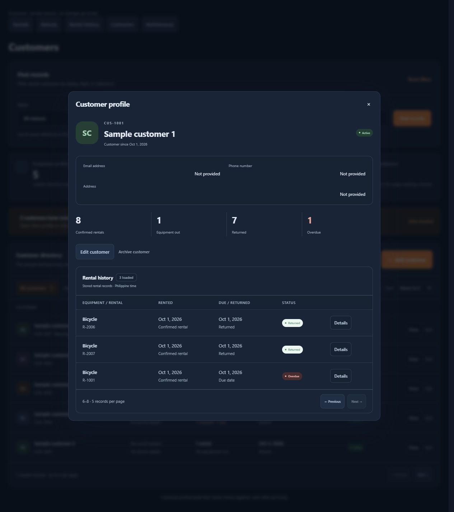
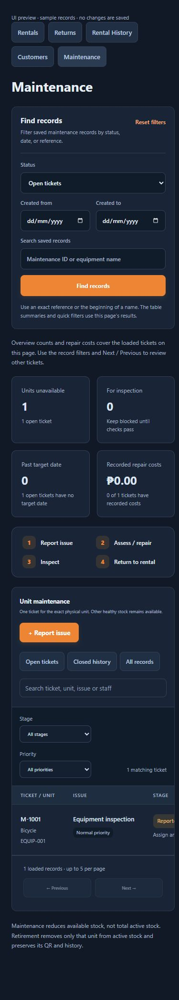

# Web, Android and backend audit — 15 October 2026

This is the latest verification snapshot. It supersedes the test counts, inventory counts, pagination defaults and APK hash in the earlier readiness report. The running web workspace is at `http://127.0.0.1:5173`; the shared backend listens on port 3000.

## Fixes and reviewed behavior

- Fixed Android account recovery rejecting a valid new password when it matched its confirmation. The password screen now validates password strength and matching confirmation separately. Added widget coverage for email → invalid OTP → valid OTP → mismatched passwords → successful reset, plus a network retry preserving the same operation key and Start over clearing password fields.
- Fixed the customer directory describing customers with recorded historical rentals as having no rentals or awaiting their first rental. It now uses the persisted rental totals even when only open rentals are loaded in the workspace.
- Clarified that paginated customer counts and maintenance overview/costs describe the loaded page. The default remains five records per page. Added browser regression coverage for fetching past customer history, Next/Previous, and opening rental details from page two. The existing fetched-history lookup was already functional; this audit strengthens its coverage and makes the selected records explicit.
- Visually reviewed the customer history dialog, rental details and Back to customer preserving the selected page. Customer and maintenance pages fit a 390-pixel viewport without horizontal document overflow; wide tables keep their own scrolling area. No browser console errors were captured during these checks. Screenshots below use disposable sample records, never live business transactions.

## Verification results

| Check | Result |
| --- | --- |
| Backend automated suite | 207 passed, 0 failed, 0 skipped, using an isolated Firestore emulator |
| Web automated suite | 175 passed, 0 failed, 0 skipped |
| Flutter automated suite | 76 passed, 0 failed |
| Total distinct automated tests | **458 passed**; focused reruns are not counted twice |
| Dart analyzer | No issues found |
| Web JavaScript checks and production build | Passed |
| Source whitespace checks | Both repositories passed `git diff --check` |
| Live database query checks | Seven successful read-only pagination/planning/ledger/summary checks |
| Live Most rented reconciliation | All-time and last-30-days derived rankings match all 11 source rentals: 7 confirmed rentals across 7 equipment groups; scope is all pages |
| Live web/mobile catalog consistency | 47 active physical units in 13 groups; all 13 groups have configured rates, 12 are currently rentable; stock counts, group IDs and scanned unit IDs agree |
| Application HTTP checks | Backend health returns 200 on localhost and the configured LAN address; workspace access without authentication returns 401 |
| Web routes and API proxy | `/transactions`, `/payments`, `/customers`, `/maintenance` and proxied health return 200; unauthenticated workspace returns 401 |

The backend integration coverage includes customer request → Owner/Operator approval → exact-unit preparation → QR handover → receipt → return inspection, walk-in rentals, reservation conflicts, extension requests, partial collections, refunds, failed-delivery custody, damaged returns and maintenance. Concurrent/repeated requests and authorization are exercised against the test database. Android tests exercise checkout, staff workflows, scanner application logic, payment forms, maintenance, history, account recovery and small-screen layouts.

Live checks were read-only. No fake customers, rentals, expenses or receipts were inserted. ESP32 remains on standby. The web server had stopped before the final smoke check; it was started again and its page routes and backend proxy were verified.

Detailed command logs are under the ignored `apps/backend/backups/system-audit-*` and `AndroidFiles/build/system-audit-*` paths. The isolated emulator and UI preview are stopped after use; the normal application servers remain running.

## Current Android artifact

The new debug APK built successfully. No phone installation was performed by this audit.

- Artifact: [app-local-debug.apk](../../../AndroidFiles/build/app/outputs/flutter-apk/app-local-debug.apk).
- Backend: `http://192.168.1.4:3000/api`; the phone must reach the laptop on the same network.
- Size: 139,887,663 bytes.
- SHA-256: `9AC59D357CDDFA0F20BCAFA229B70031B9849C0E080483211F952B4FC3060DD7`.
- Restored and hash-verified the exact pre-build state of all 494 tracked generated Flutter cache files, preserving existing work.

Build tools emitted compatibility warnings for future Flutter/Kotlin versions, Java native access and SDK XML versions. They did not prevent this build. This audit does not include an SDK/dependency migration.

## Remaining acceptance checks

Actual camera optical scanning and Bluetooth output on the 55 mm continuous roll remain deferred at the user's request. Real email delivery/inbox appearance was not exercised by sending a live password-reset email in this audit. Automated recovery tests cover the application and backend behavior.

Passing checks establish the scenarios tested here. They cannot establish that every device, external service and future scenario is free of defects. Older rental records without original pricing or payment evidence remain visibly identified; this audit does not invent missing history.

